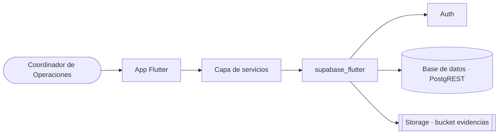

# Architectural spine · RutaViva

## Resumen

RutaViva es una app Flutter (web y Android) para el área de Operaciones, con
backend en Supabase (Auth, base de datos Postgres vía PostgREST y Storage). No hay
servidor propio: la telemetría y las predicciones de falla, que en el trabajo
académico previo se pensaron sobre un data lake con streaming en tiempo real
(MQTT/Kafka), aquí se simulan como filas que se cargan por lotes en Postgres (una
migración de datos de ejemplo) y se leen igual que el resto de los datos: esa es la
adaptación principal frente al diseño original del Caso 4.

## Diagrama

## Stack

- Frontend: Flutter 3.x y Dart 3.x. Plataformas: web y Android.
- SDK: `supabase_flutter`.
- Paquetes: `image_picker` (elegir la foto de evidencia de la galería o la cámara).
- Backend: Supabase con Auth, base de datos (Postgres + PostgREST) y Storage.
- Esquema: migraciones del CLI de Supabase en `supabase/migrations/`.

## Qué cubre cada servicio

- **Auth**: cuentas del equipo de Operaciones con correo y contraseña. La
  confirmación de correo está apagada. Un único rol en esta fase (coordinador).
- **Base de datos**: las entidades de `docs/modelo.md` (basado en
  `MR_RutaViva.pdf`): `zona`, `conductor`, `vehiculo`, `asignacion_turno`, `viaje`,
  `evento_conduccion`, `telemetria_gps`, `telemetria_obd`, `prediccion_falla`,
  `mantenimiento`, `cliente_retailer`, `orden_entrega` y `usuario`, más
  `evidencia_mantenimiento` (RF-13) y `parametro` (la meta de OTD, RF-09).
- **Storage**: bucket **público** `evidencias` con las fotos de los mantenimientos
  (RF-13). Ruta `<id_mantenimiento>/<milisegundos>.jpg`.

## Invariantes

### AD-01 · Sin backend propio

- **Regla:** la app habla directo con Supabase a través de `supabase_flutter`.
- **Evita:** montar un servidor intermedio para una sola pantalla o reconstruir la
  arquitectura de data lake del trabajo académico previo.

### AD-02 · Una capa de servicios

- **Regla:** solo los servicios de `lib/services/` (`AuthService`, `UsuarioService`,
  `FleetService`, `MaintenanceService`, `OrderService`, `ParametroService`,
  `EvidenciaService`, `StorageService`) llaman a Supabase, y `FotoService` a la
  galería del dispositivo; las pantallas les piden los datos a ellos.
- **Evita:** llamadas repetidas y distintas a la misma tabla regadas por las
  pantallas.

### AD-03 · El usuario es el de Auth

- **Regla:** la fila de `usuario` guarda el `uuid` de Auth en `auth_uuid`, y el rol
  vive en esa fila, no en los metadatos de Auth. Lo que registra o revisa alguien
  del equipo apunta a esa fila.
- **Evita:** dos identidades para la misma persona.

### AD-04 · has_telemetry decide la vista

- **Regla:** un vehículo con `has_telemetry = falso` nunca muestra telemetría en
  tiempo real ni alertas predictivas; solo mantenimiento preventivo por
  kilometraje.
- **Evita:** que la falta de datos distorsione los indicadores agregados de la
  flota completa.

### AD-05 · La predicción de falla no se calcula en la app

- **Regla:** `prediccion_falla` se carga como dato (migración de datos de ejemplo);
  la app solo la lee, la programa o la descarta.
- **Evita:** construir un motor de machine learning dentro de Flutter, que está
  fuera del alcance (ver PRD).

### AD-06 · Llaves fuera del código

- **Regla:** la URL y la publishable key de Supabase se leen con
  `String.fromEnvironment` desde `env.json` (`--dart-define-from-file=env.json`),
  que no se sube al repositorio. La secret key nunca se usa.
- **Evita:** exponer las llaves en el repositorio o tener que cambiarlas archivo
  por archivo.

### AD-07 · Los archivos van en Storage

- **Regla:** la foto se sube al bucket `evidencias` con un nombre nuevo en cada
  subida; la tabla `evidencia_mantenimiento` guarda solo la ruta y la URL pública.
- **Evita:** guardar imágenes dentro de la base de datos o mostrar una foto vieja
  por caché.

### AD-08 · El esquema solo cambia por migraciones

- **Regla:** las tablas se crean y cambian con migraciones en
  `supabase/migrations/`; una migración subida no se edita, se crea otra. Cada
  tabla lleva su `grant` para `anon` y `authenticated`. Las tablas conservan los
  nombres del modelo del Caso 4 (español, singular, llaves numéricas) en vez de la
  convención sugerida en clase (inglés, plural, `uuid`), para que coincidan con
  `MR_RutaViva.pdf` y con el código de la Entrega 2.
- **Evita:** que la base de datos del equipo y el modelo entregado se separen.

## Diferido

- Streaming real de telemetría (MQTT/Kafka): se simula con datos cargados por
  lotes.
- Integración real (API/SFTP) con los cinco retailers: se usan datos de ejemplo
  sobre el modelo canónico de orden.
- Edge Functions, Realtime y seguridad por filas (RLS) en las tablas de la app: el
  curso las deja fuera. Storage sí necesita sus policies sobre `storage.objects`
  (INSERT y SELECT para `authenticated`).
- Rol de Mecánico (acceso limitado a mantenimiento): fuera de esta fase; el campo
  `usuario.rol` ya lo deja abierto para una v2.

## Historial

- 0.3.0 · 2026-11-26 · Entrega 3. Storage pasa de *sin uso* al bucket `evidencias`
  (RF-13). Se agregan AD-07 y AD-08, el paquete `image_picker`, las tablas
  `evidencia_mantenimiento` y `parametro`, y la forma concreta de AD-06. AD-03 deja
  explícito que el rol vive en `usuario`.
- 0.1.0 · 2026-11-06 · Primera versión, adaptando el diseño del Caso 4 al patrón
  Flutter + Supabase del curso. Pendiente de revisión por el equipo.
