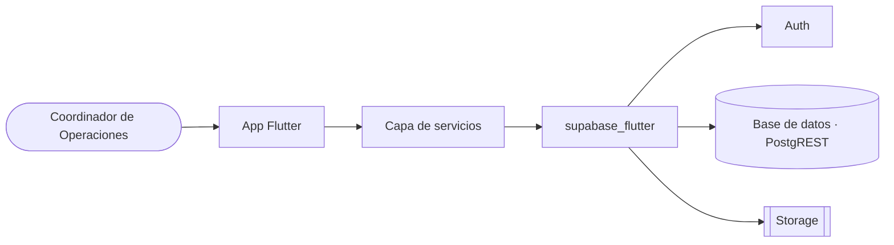

# Architectural spine · RutaViva

## Resumen

RutaViva es una app Flutter (web y Android) para el área de Operaciones, con
backend en Supabase (Auth, base de datos Postgres vía PostgREST y Storage). No hay
servidor propio: la telemetría y las predicciones de falla, que en el trabajo
académico previo se pensaron sobre un data lake con streaming en tiempo real
(MQTT/Kafka), aquí se simulan como filas que se cargan por lotes en Postgres y se
leen igual que el resto de los datos — esa es la adaptación principal frente al
diseño original del Caso 4.

## Diagrama

## Stack

- Frontend: Flutter 3.x y Dart 3.x. Plataformas: web y Android.
- SDK: `supabase_flutter`.
- Backend: Supabase con Auth, base de datos (Postgres + PostgREST) y Storage.

## Qué cubre cada servicio

- **Auth**: cuentas del equipo de Operaciones. Por ahora, un único rol
  (Coordinador de Operaciones) — a confirmar si se necesitan más roles.
- **Base de datos**: las entidades ya diseñadas en `docs/modelo.md` (basado en
  `MR_RutaViva.pdf`): `vehiculo`, `conductor`, `zona`, `asignacion_turno`, `viaje`,
  `evento_conduccion`, `telemetria_gps`, `telemetria_obd`, `mantenimiento`,
  `prediccion_falla`, `orden_entrega`, `cliente_retailer`, `usuario`.
- **Storage**: sin un uso identificado todavía (ver Diferido). Si el equipo decide
  guardar evidencia fotográfica de un mantenimiento, iría aquí.

## Invariantes

### AD-01 · Sin backend propio

- **Regla:** la app habla directo con Supabase a través de `supabase_flutter`.
- **Evita:** montar un servidor intermedio para una sola pantalla o reconstruir la
  arquitectura de data lake del trabajo académico previo.

### AD-02 · Una capa de servicios

- **Regla:** solo los servicios de la app (por ejemplo `FleetService`,
  `MaintenanceService`, `OrderService`) llaman a Supabase; las pantallas les piden
  los datos a ellos.
- **Evita:** llamadas repetidas y distintas a la misma tabla regadas por las
  pantallas.

### AD-03 · El usuario es el de Auth

- **Regla:** toda fila que pertenece a alguien del equipo de Operaciones guarda el
  `uuid` de Auth.
- **Evita:** dos identidades para la misma persona.

### AD-04 · has_telemetry decide la vista

- **Regla:** un vehículo con `has_telemetry = falso` nunca muestra telemetría en
  tiempo real ni alertas predictivas; solo mantenimiento preventivo por
  kilometraje.
- **Evita:** que la falta de datos distorsione los indicadores agregados de la
  flota completa.

### AD-05 · La predicción de falla no se calcula en la app

- **Regla:** `prediccion_falla` se carga como dato (de un dataset de ejemplo o de
  un proceso externo); la app solo la lee y la muestra.
- **Evita:** construir un motor de machine learning dentro de Flutter, que está
  fuera del alcance (ver PRD).

### AD-06 · Llaves fuera del código

- **Regla:** la URL y la publishable key de Supabase se leen de la configuración,
  no se escriben en cada archivo.
- **Evita:** exponer las llaves en el repositorio o tener que cambiarlas archivo
  por archivo.

## Diferido

- Streaming real de telemetría (MQTT/Kafka): se simula con datos cargados por
  lotes.
- Integración real (API/SFTP) con los cinco retailers: se usan datos de ejemplo
  sobre el modelo canónico de orden.
- Edge Functions, Realtime y seguridad por filas (RLS): el curso las deja fuera
  para mantener la app ligera.
- Uso de Storage: a definir con el equipo.
- Rol de Mecánico (acceso limitado a mantenimiento): fuera de esta fase por tiempo
  del curso; el campo `USUARIO.rol` del modelo ya lo deja abierto para una v2.

## Historial

- 0.1.0 · 2026-11-06 · Primera versión, adaptando el diseño del Caso 4 al patrón
  Flutter + Supabase del curso. Pendiente de revisión por el equipo.
