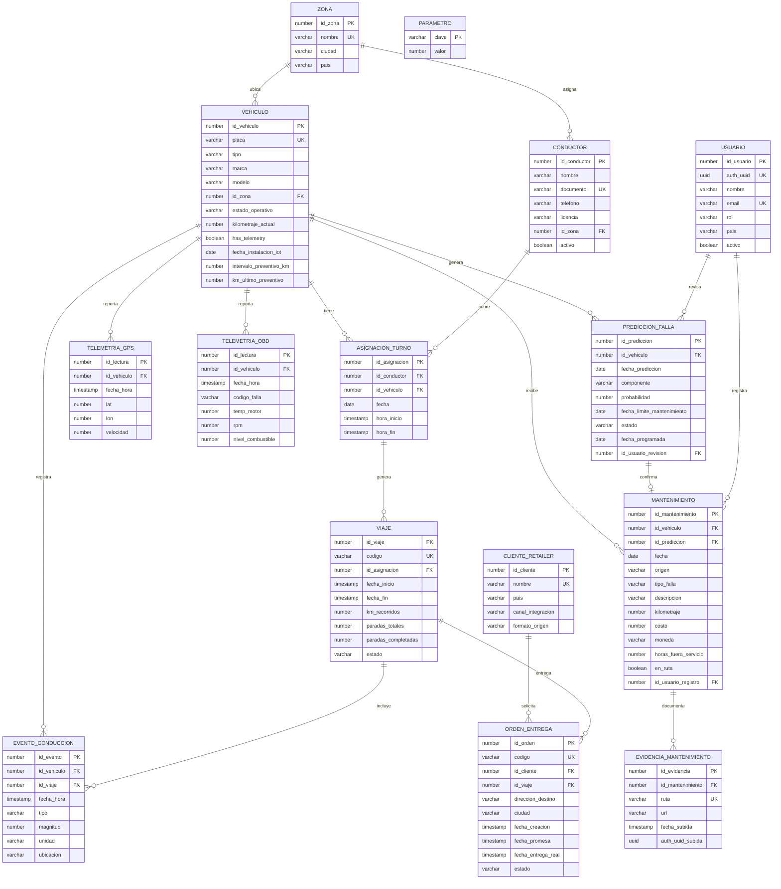

# Modelo de datos · RutaViva

Transcripción en texto del diagrama MER de `MR_RutaViva.pdf`, para que los agentes
y las skills puedan leerlo. El PDF original sigue siendo la referencia visual para
la entrega (diagrama MER pedido en la Entrega 1).

## Notas para el backend en Supabase

- `VEHICULO.has_telemetry` es la bandera central (AD-04 de `architectural_spine.md`):
  decide si un vehículo aparece en las vistas de telemetría/predicción o solo en
  mantenimiento preventivo por kilometraje.
- `PREDICCION_FALLA` y `MANTENIMIENTO` se enlazan por `id_prediccion`: un
  mantenimiento puede confirmar (o no) una predicción.
- `USUARIO` representa a quien usa la app (hoy, el Coordinador de Operaciones); su
  fila debe enlazarse con el `uuid` de Supabase Auth cuando se implemente (AD-03).
- `TELEMETRIA_GPS` y `TELEMETRIA_OBD` se cargan por lotes (no hay streaming real;
  ver *Diferido* en `architectural_spine.md`).

## Cambios de la Entrega 3 frente a `MR_RutaViva.pdf`

- `USUARIO.auth_uuid`: el `uuid` de la cuenta en Supabase Auth (AD-03). Es único y
  apunta a `auth.users`.
- `PREDICCION_FALLA.fecha_programada`: la fecha de la intervención programada desde
  una alerta (RF-02). `estado` toma `pendiente`, `programada`, `confirmada` o
  `descartada`.
- `EVENTO_CONDUCCION.unidad`: la unidad de `magnitud` (`g` o `km/h`).
- `MANTENIMIENTO.id_usuario_registro` admite nulo: los mantenimientos históricos de
  los datos de ejemplo no los registró nadie de la app.
- `EVIDENCIA_MANTENIMIENTO` (nueva, RF-13): una fila por foto subida al bucket
  `evidencias`; si se borra el mantenimiento, se borran sus filas.
- `PARAMETRO` (nueva, RF-09): valores configurables de la app; hoy solo
  `meta_otd` (fracción, 0,95 = 95 %).

## Historial

- 0.2.0 · 2026-11-26 · Entrega 3: columnas `auth_uuid`, `fecha_programada` y
  `unidad`, tablas `EVIDENCIA_MANTENIMIENTO` y `PARAMETRO`.

- 0.1.0 · 2026-11-06 · Transcripción inicial desde `MR_RutaViva.pdf`.
